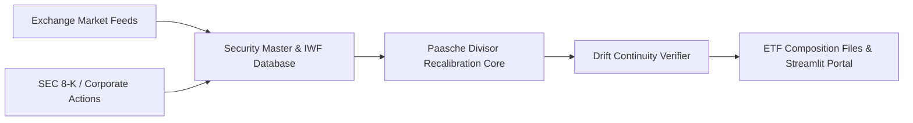

# S&P Global Index Management & Corporate Action Divisor Engine (SPDJI-Rebalance-Net)

An institutional-grade index calculation, corporate action processing, Paasche divisor recalibration, and free-float (IWF) reconciliation engine designed for S&P Dow Jones Indices Index Management & Operations.

## System Architecture



## Key Capabilities
- **Paasche Divisor Continuity:** Automatically recalibrates the index divisor across special cash dividends, mergers, spin-offs, and constituent substitutions with drift $< 10^{-7}$.
- **Stock Split Neutrality:** Adjusts constituent prices and share counts symmetrically without causing index level jumps.
- **Feed Discrepancy Auditing:** Compares internal security master data against external vendor feeds (Refinitiv, Bloomberg) to flag price or share deviations prior to market close.
- **Interactive Operations Portal:** Streamlit dashboard providing real-time divisor adjustment simulation and portfolio composition file monitoring.

## Core Modules
- `src/core_engine.py`: Constituent structures, modified Paasche index level formula, corporate action divisor recalibrations, and feed reconciliation.
- `app/streamlit_app.py`: Streamlit operations control workbench.
- `tests/test_core.py`: Comprehensive test suite verifying splits, dividends, replacements, and data feed integrity.

## Quickstart
```bash
pip install -r requirements.txt
python -m pytest tests/ -v
streamlit run app/streamlit_app.py
```

## Author
Bhupesh Chandra Dimri (bhupeshcdimri21@gmail.com)  
M.S. in Accounting Analytics & Data Technology, Pace University  
Bloomberg BMC & BFF Certified • Oracle Cloud ERP Certified
